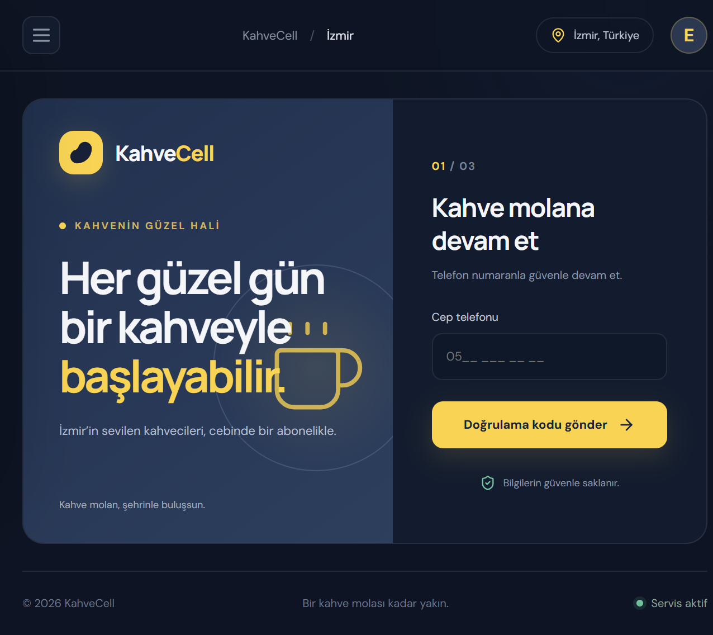
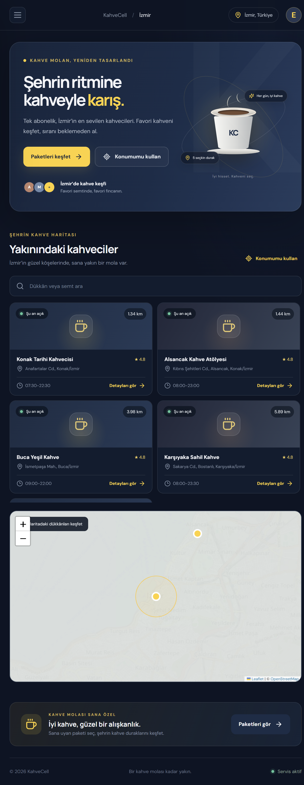
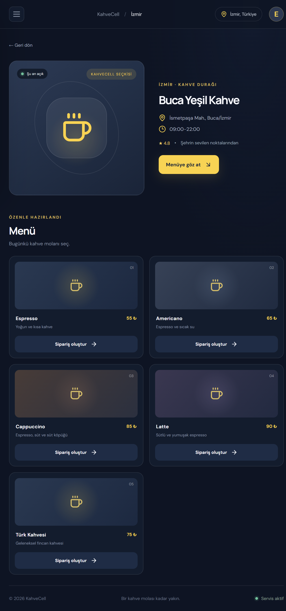
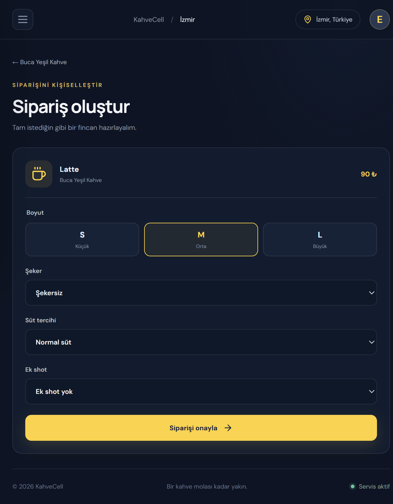
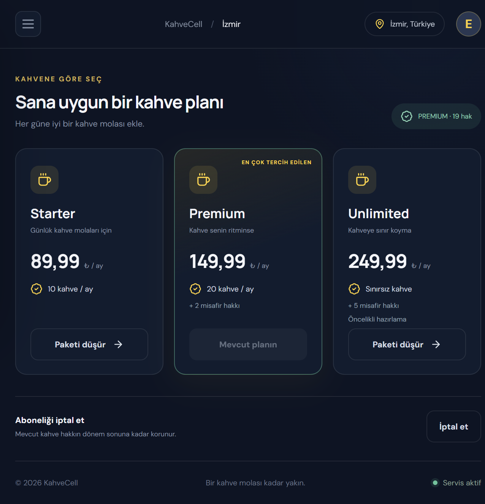
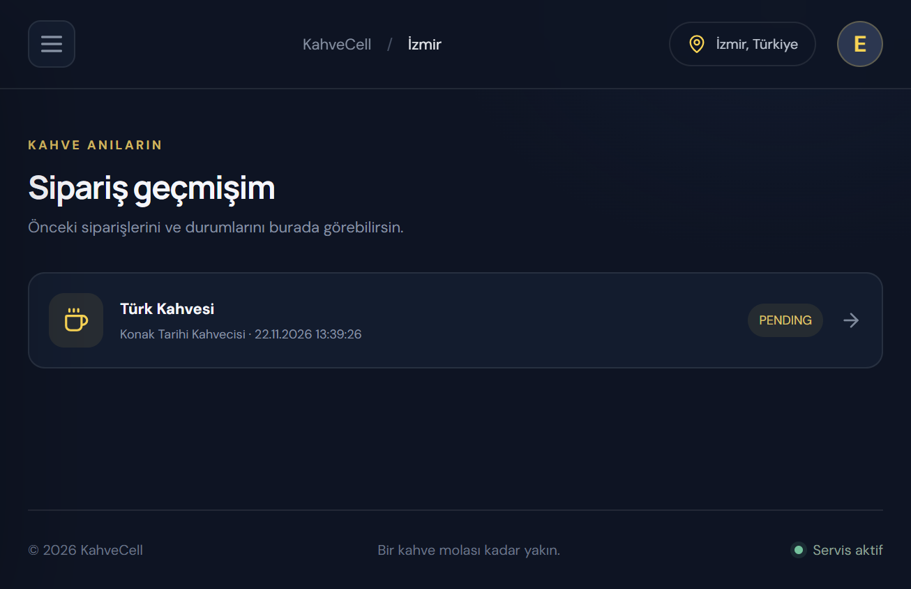
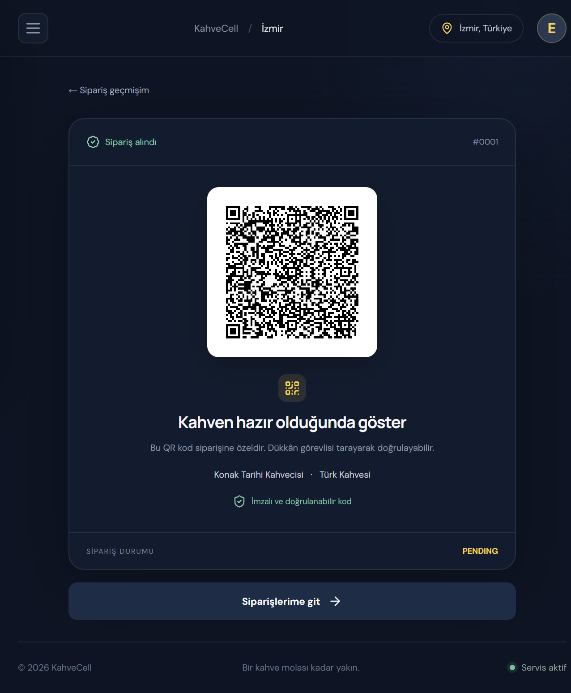

# KahveCell

KahveCell is a coffee subscription demo for discovering cafés, buying a monthly plan, and placing QR-code pickup orders.

## Stack

- Backend: Python, FastAPI, SQLAlchemy, SQLite
- Frontend: React, Vite, React Router
- Map: Leaflet / OpenStreetMap

## Run locally (Windows PowerShell)

### Backend

```powershell
cd backend
py -m venv .venv
.\.venv\Scripts\Activate.ps1
pip install -r requirements.txt
uvicorn app.main:app --reload
```

API docs: http://127.0.0.1:8000/docs

### Frontend (in a second terminal)

```powershell
cd frontend
npm install
npm run dev
```

Web app: http://127.0.0.1:5173

## Screenshots

| Sign in / Register | Discover cafés and map |
|---|---|
|  |  |

| Café details and menu | Customize an order |
|---|---|
|  |  |

| Subscription plans | Order history |
|---|---|
|  |  |

| Signed order QR |
|---|
|  |

## Demo notes

- SMS OTP is simulated; the fixed demo code is `1234`.
- Payment is simulated; card numbers ending in `4242` succeed and those ending in `0000` fail.
- No real SMS or card payment is performed. Do not use this demo configuration in production.
- The database is local at `backend/kahvecell.db` and is intentionally not committed.
- Run `python seed.py` from `backend` to add the sample İzmir cafés and demo accounts.
